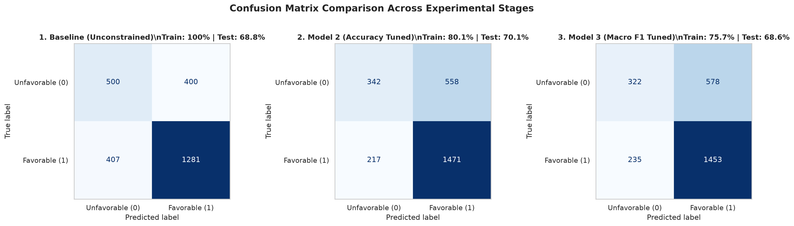
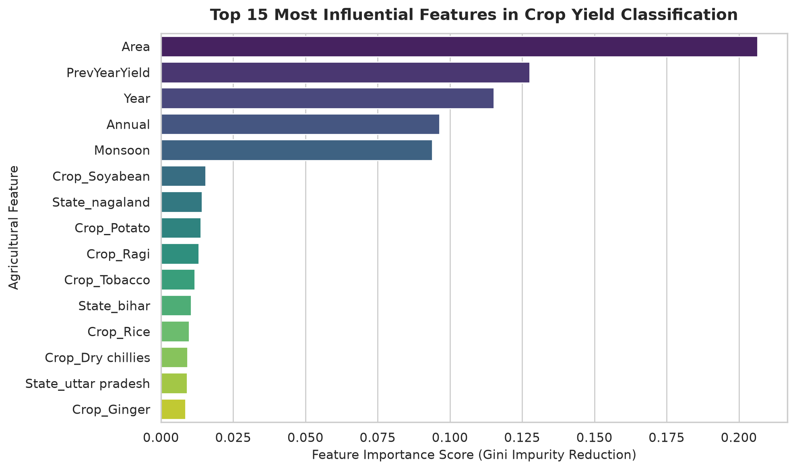

# Indian Agriculture & Rainfall Analysis: Crop Yield Prediction

[](https://www.python.org/)
[](https://scikit-learn.org/)
[](https://github.com/astral-sh/uv)
[](https://github.com/deringirish/indian-agriculture-rainfall-decision-tree-classifier/actions/workflows/ci.yml)
[](LICENSE)

A structured machine learning project analyzing the interplay between Indian rainfall patterns and agricultural crop yield outcomes using Decision Tree Classification. This project demonstrates end-to-end data preparation, pipeline construction, baseline model diagnosis, hyperparameter tuning via cross-validation, and feature importance interpretation.

---

## 📌 Project Overview & Problem Statement

Agriculture in India is deeply tied to climatic factors, especially annual precipitation and seasonal monsoon patterns. 

The primary objective of this project is to build an interpretable binary classification model that predicts whether a crop yield outcome is:
- **Favorable (Target = 1)**: Yield meets or exceeds benchmark expectations.
- **Unfavorable (Target = 0)**: Yield falls below benchmark expectations.

By understanding the factors that dictate yield outcomes, agricultural planners, policymakers, and farmers can better anticipate crop risks and plan resource allocation accordingly.

---

## 📊 Dataset Details

The dataset consolidates multi-decade historical records of Indian agriculture, crop cultivation, and regional rainfall:
- **Time Span:** 1998 to 2017
- **Dataset Source:** [Kaggle - Indian Agriculture and Rainfall Data (1998-2017)](https://www.kaggle.com/datasets/cccodelao/indian-agriculture-and-rainfall-data-1998-2017)
- **Primary Features:**
  - `State`: Indian state or union territory.
  - `Crop`: Type of crop cultivated.
  - `Year`: Year of observation.
  - `Area`: Land area allocated for cultivation (hectares).
  - `Annual`: Total annual rainfall (mm).
  - `Monsoon`: Seasonal monsoon rainfall (mm).
  - `PrevYearYield`: Crop yield achieved in the preceding year (metric tons/hectare).
  - `Target`: Binary yield classification label (0 or 1).

---

## 📁 Repository Structure

```text
.
├── .github/
│   └── workflows/
│       └── ci.yml                                # Automated CI testing pipeline
├── assets/
│   ├── confusion_matrix_comparison.png           # Visual evaluation across stages
│   └── feature_importance_top15.png              # Top 15 influential features plot
├── data/
│   └── AgricultureRainfall_1998-2017.csv         # Historical dataset
├── notebooks/
│   └── indian_agri_rainfall_decision_tree_classification.ipynb  # Primary documented workflow notebook
├── src/
│   └── indian_agriculture_rainfall_decision_tree_classifier/
│       └── __init__.py                           # Modular Python package
├── .gitignore                                    # Git ignore configuration
├── .python-version                               # Python 3.14+ version pin
├── LICENSE                                       # MIT License
├── pyproject.toml                                # Project metadata and dependencies
├── README.md                                     # Project documentation
└── uv.lock                                       # Deterministic dependency lockfile
```

---

## 🛠️ Environment Setup & Installation

This project is configured to run with **Python 3.14+** using [`uv`](https://github.com/astral-sh/uv) for fast and reproducible package management.

### Option 1: Using `uv` (Recommended)

1. Clone or download the repository:
   ```bash
   git clone https://github.com/deringirish/indian-agriculture-rainfall-decision-tree-classifier.git
   cd indian-agriculture-rainfall-decision-tree-classifier
   ```

2. Synchronize virtual environment and dependencies:
   ```bash
   uv sync
   ```

3. Launch the Jupyter Notebook environment:
   ```bash
   uv run jupyter notebook
   ```

### Option 2: Using Standard `pip`

```bash
python -m venv .venv
# Windows:
.venv\Scripts\activate
# Linux/macOS:
source .venv/bin/activate

pip install pandas numpy matplotlib seaborn scikit-learn notebook ipykernel
```

---

## 🔄 Machine Learning Workflow

The workflow is structured into logical, reproducible stages:

1. **Exploratory Data Analysis (EDA):**
   - Summary statistics and missing value assessment.
   - Class imbalance inspection: Target = 1 (~65.2%) vs. Target = 0 (~34.8%).
2. **Data Cleaning:**
   - Removal of records missing `PrevYearYield` (cannot establish crop performance trajectory without baseline yield).
3. **Train-Test Splitting:**
   - Stratified 80/20 split (`random_state=102`) to ensure both subsets preserve identical class proportions.
4. **Pipeline Construction:**
   - One-Hot Encoding for categorical features (`State`, `Crop`) with unknown handling.
   - Passthrough for numerical features (Decision trees do not require feature scaling).
5. **Model Experiments & Iterative Tuning:**
   - **Trial 1 (Baseline):** Default, unconstrained Decision Tree.
   - **Trial 2 (Accuracy-Focused Tuning):** 5-Fold Grid Search over tree depth, split limits, and leaf sizes.
   - **Trial 3 (Macro F1-Focused Tuning):** Regularized tuning optimizing balanced performance across both classes.
6. **Feature Importance Interpretation:**
   - Extracting Gini importance scores across all features to isolate the key drivers of crop yield outcomes.

---

## 📈 Experimental Results & Model Comparison

| Model | Train Accuracy | Test Accuracy | Macro F1 | Class 0 Recall | Class 1 Recall | Generalization Gap | Status |
| :--- | :---: | :---: | :---: | :---: | :---: | :---: | :--- |
| **Baseline (Unconstrained)** | 100.00% | 68.82% | 0.6569 | 0.5556 | 0.7589 | 31.18% | Severe Overfitting |
| **Model 2 (Accuracy Tuned, max_depth=15)** | **80.11%** | **70.05%** | **0.6302** | 0.3800 | **0.8714** | **10.06%** | **Best Accuracy & Balance** |
| **Model 3 (Macro F1 Tuned, min_leaf=5)** | 75.68% | 68.59% | 0.6117 | 0.3578 | 0.8608 | 7.09% | Strongest Regularization |

### Confusion Matrix Comparison Across Stages



### Key Diagnostic Insights:
- **Baseline Overfitting:** An unconstrained tree achieves 100% training accuracy by memorizing training set noise, resulting in poor generalization on unseen test data (gap of 31.18%).
- **Pruning Effect:** Restricting `max_depth` to 15 drops the generalization gap from 31.18% down to 10.06% while boosting test accuracy to 70.05%.
- **Primary Predictors:** The most influential features driving yield predictions are:
  1. `PrevYearYield` (Previous Year Yield)
  2. `Area` (Cultivated Land Area)
  3. `Monsoon` (Monsoon Season Rainfall)
  4. `Annual` (Annual Rainfall)

### Top 15 Most Influential Features



---

## 🔮 Future Enhancements

- **Ensemble Algorithms:** Train Random Forest and Gradient Boosted Trees (XGBoost / LightGBM) to reduce variance and improve recall on unfavorable yields.
- **Cost-Sensitive Learning:** Apply class weights (`class_weight='balanced'`) to prevent majority class bias.
- **Interactive Web App:** Build a Streamlit or FastAPI interface allowing users to input state, crop, and rainfall projections for real-time yield forecasts.

---

## 👤 Author & Acknowledgments

- **Author:** Derin Girish ([@deringirish](https://github.com/deringirish))
- **Dataset Credit:** [Kaggle Dataset by cccodelao](https://www.kaggle.com/datasets/cccodelao/indian-agriculture-and-rainfall-data-1998-2017)

---

## 📄 License

This project is open-source and available under the [MIT License](LICENSE).
